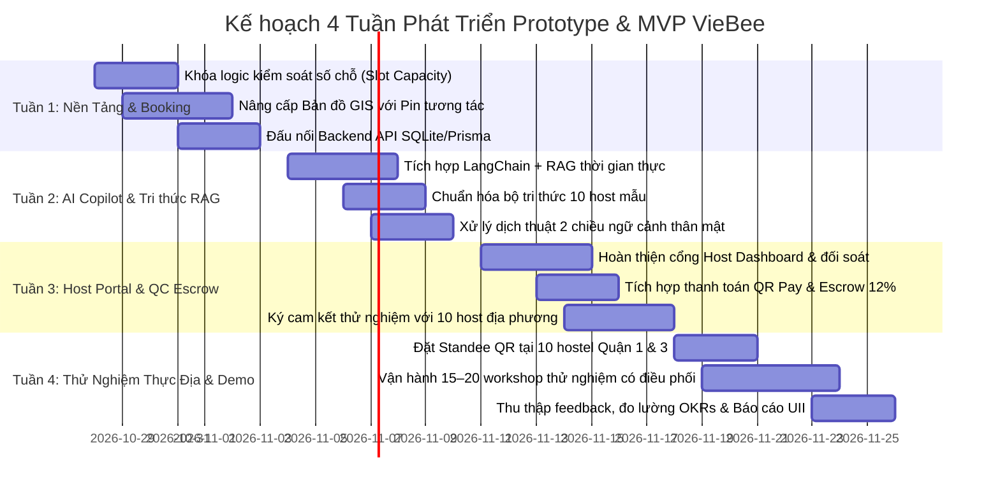

# KẾ HOẠCH PHÁT TRIỂN PROTOTYPE & MVP TRONG 4 TUẦN
## VieBee — Mapping Living Heritage, Empowering Communities
### UEH University of Economics Ho Chi Minh City • UII SANDBOX 2026

> **Cột mốc:** Milestone Presentation (Thứ Ba, 27/10/2026)  
> **Thời hạn nộp slide:** 23h59, Chủ Nhật, 25/10/2026  
> **Tài liệu căn cứ:** `VieBee - Work Traking.md`, `Viebee_Document.md`, Codebase `viebee/` & `backend/`

---

## 1. TỔNG QUAN VỀ SẢN PHẨM & MỤC TIÊU MVP (EXECUTIVE SUMMARY)

**VieBee** là nền tảng du lịch trải nghiệm P2P (Peer-to-Peer) kết nối trực tiếp khách du lịch quốc tế tự túc với các nghệ nhân và người nấu ăn gia đình bản địa tại TP. Hồ Chí Minh. Thông qua **Bản đồ Văn hóa Số (GIS Cultural Map)** và **Trợ lý Văn hóa AI (AI Cultural Copilot)** thời gian thực, VieBee gỡ bỏ rào cản ngôn ngữ và địa lý, giúp người dân dễ dàng thương mại hóa tri thức văn hóa sống (Living Heritage) với mức phí nền tảng chỉ **12%** (so với mức ~20% của Airbnb).

### 4 Phân hệ người dùng trong MVP:
1. **Traveler Portal (Khách du lịch quốc tế):** Khám phá bản đồ ngõ hẻm theo định vị, xem câu chuyện di sản, chọn khung giờ, đặt chỗ tức thì (Instant RSVP), nhận vé điện tử kèm mã QR Token, và chat hỏi đáp/dịch tự động qua AI.
2. **Host Portal (Nghệ nhân / Người nấu ăn bản địa):** Quy trình đăng ký trải nghiệm 3 bước siêu đơn giản, quản lý khung giờ và số chỗ (capacity), theo dõi danh sách khách đặt, và minh bạch thu nhập nhận về 88%.
3. **AI Cultural Copilot (LangChain + RAG):** Dịch hai chiều Anh ↔ Việt thân mật, tự động đối soát câu hỏi của khách với bảng tri thức đã xác thực của host (nguyên liệu, dị ứng, tập quán, quy tắc tháo giày, cách chào hỏi).
4. **Admin & QC Portal (Hội đồng thẩm định UEH UII):** Quy trình kiểm duyệt chất lượng 3 bước (thân nhân, tay nghề, không gian an toàn), cấp huy hiệu "QC Verified", quản lý khiếu nại và giao dịch.

---

## 2. KHUNG MỤC TIÊU & CHỈ SỐ THEN CHỐT (OKRs & METRICS)

Để đảm bảo chuyển giao từ ý tưởng sang sản phẩm chạy thực tế (working software) phục vụ giai đoạn In-person Phase:

### Objective (Mục tiêu tổng quát):
> **"Hoàn thiện và đưa vào vận hành thử nghiệm thực địa 01 MVP hoàn chỉnh, ổn định trong 4 tuần; tổ chức thành công các workshop di sản đầu tiên tại Quận 1 & Quận 3 với phản hồi hài lòng cao từ du khách quốc tế và nghệ nhân."**

### Key Results (KRs) kết hợp Lead & Lag Measures:

| Loại chỉ số | Mã | Nội dung Key Result | Tiêu chuẩn đạt (Pass Criteria) |
|---|---|---|---|
| **Lead (Hành động)** | **KR 1** | Onboard và lập hồ sơ tri thức RAG cho **10 nghệ nhân/host bản địa** tại Quận 1, 3, Bình Thạnh. | $\ge 10$ workshops hoàn tất thẩm định QC và sẵn sàng nhận khách. |
| **Lead (Hành động)** | **KR 2** | Triển khai **10 Standee / Poster mã QR** tại các boutique hostel, khách sạn đối tác ở Quận 1 & 3. | $\ge 150$ lượt quét QR truy cập bản đồ di sản VieBee. |
| **Lag (Kết quả)** | **KR 3** | Đạt tối thiểu **30 lượt đặt chỗ RSVP thành công** trong giai đoạn thử nghiệm có giám sát. | $\ge 30$ lượt hoàn thành workshop; tỷ lệ chuyển đổi $\ge 7\%$. |
| **Lag (Kết quả)** | **KR 4** | Kiểm chứng giả thuyết H2: Du khách và host giao tiếp mượt mà qua AI Copilot không cần thông dịch viên. | Điểm hài lòng $\ge 4.2 / 5.0$; $\ge 80\%$ buổi workshop không cần người dịch hỗ trợ. |
| **Lag (Kết quả)** | **KR 5** | Kiểm chứng giả thuyết H3: Mức giá 400.000 – 500.000 VNĐ và mức chiết khấu **12% take rate**. | $\ge 80\%$ host chấp thuận mô hình nhận về 88% doanh thu. |

---

## 3. LỘ TRÌNH TRIỂN KHAI 4 TUẦN CHI TIẾT (4-WEEK SPRINT ROADMAP)

*Thời gian thực hiện: Từ 28/10/2026 đến 25/11/2026 (trước thềm Vòng Realization Round 2)*

### 🗓️ Tuần 1 (28/10 – 03/11/2026): Ổn định Core Booking & Bản đồ GIS Tương tác
- **Mục tiêu:** Khắc phục triệt để các lỗi logic rà soát được từ đợt Audit; đảm bảo luồng đặt chỗ không bị overbook và bản đồ hiển thị tọa độ thực tế.
- **Nhiệm vụ cụ thể:**
  1. *Fix lỗi Slot Capacity:* Cập nhật logic `mockHttpAdapter` và Backend kiểm tra nghiêm ngặt `(bookedCount + guestsCount) <= capacity`. Khóa nút đặt chỗ khi khung giờ đầy.
  2. *Interactive GIS Cultural Map:* Thay thế iframe OpenStreetMap tĩnh bằng Leaflet / MapLibre với các pin marker định vị chính xác 6 điểm di sản (Hẻm Bàn Cờ, Thanh Đa, Chợ Lớn...). Cho phép click pin để mở card xem nhanh.
  3. *Backend API Data Seeding:* Nạp sẵn seed data 6 workshops vào backend NestJS, hỗ trợ chạy song song chế độ LocalStorage Mock và Backend REST API.
- **Bàn giao (Deliverable):** Bản build web có thể click pin bản đồ mượt mà và thực hiện luồng đặt chỗ có chặn quá tải chỗ ngồi.

### 🗓️ Tuần 2 (04/11 – 10/11/2026): Tích hợp Trợ lý Văn hóa AI (LangChain + RAG)
- **Mục tiêu:** Biến tính năng AI Copilot từ bộ giả lập từ khóa thành luồng RAG thực thụ, trả lời chính xác dựa trên hồ sơ di sản của host.
- **Nhiệm vụ cụ thể:**
  1. *Thiết lập RAG Pipeline:* Xây dựng pipeline LangChain kết nối OpenAI / Gemini API, nạp văn bản tri thức chuẩn của từng workshop (lịch sử, nguyên liệu, quy tắc ứng xử, an toàn).
  2. *Prompt Engineering chuẩn văn hóa Việt:* Tinh chỉnh system prompt để bản dịch tiếng Việt mang đại từ nhân xưng kính trọng, ấm áp ("Dạ con chào Bà...", "Dạ khách muốn hỏi về...").
  3. *Bilingual Etiquette Guidance:* Trả lời khách quốc tế bằng tiếng Anh tự nhiên kèm lưu ý văn hóa tức thì khi phát hiện câu hỏi về phong tục, trang phục hoặc dị ứng thực phẩm.
- **Bàn giao (Deliverable):** Cửa sổ chat AI Copilot trả lời trơn tru, dịch chuẩn và trích dẫn đúng tri thức từ host sheet.

### 🗓️ Tuần 3 (11/11 – 17/11/2026): Hoàn thiện Cổng Host, Hệ thống QC & Ký kết 10 Host
- **Mục tiêu:** Đảm bảo đối tượng nghệ nhân lớn tuổi có thể sử dụng dễ dàng và quy trình kiểm duyệt an toàn được kích hoạt.
- **Nhiệm vụ cụ thể:**
  1. *Đơn giản hóa giao diện Host:* Tối ưu hóa Host Dashboard với font chữ to, nút bấm rõ ràng, hiển thị lịch khách đến và doanh thu nhận về 88% bằng số tiền VNĐ cụ thể.
  2. *Cơ chế Escrow & QR Pay:* Tích hợp giả lập thanh toán chuyển khoản MoMo / Vietcombank qua mã VietQR, tiền được giữ tại hệ thống và giải ngân cho host sau khi workshop hoàn thành.
  3. *Thẩm định thực địa 10 Host:* Nhóm trực tiếp đến nhà 10 nghệ nhân tại Quận 1, Quận 3 và Bình Thạnh (nấu chè bưởi, đan tre, làm gốm mini, thêu tay, pha trà sen) để chụp ảnh, kiểm tra vệ sinh/an toàn và cấp mã xác thực QC.
- **Bàn giao (Deliverable):** Danh mục 10 workshops thật được kích hoạt trên hệ thống; cổng Admin QC phê duyệt hoàn chỉnh.

### 🗓️ Tuần 4 (18/11 – 24/11/2026): Thử nghiệm Thực địa, Phân phối Hostel & Báo cáo OKRs
- **Mục tiêu:** Đưa sản phẩm ra ngoài đời thực, tiếp cận khách du lịch quốc tế tại TP.HCM và thu thập dữ liệu kiểm chứng.
- **Nhiệm vụ cụ thể:**
  1. *Triển khai kênh GTM Hostel:* Đặt standee và tờ rơi có mã QR tại 5–10 hostel thân thiện tại Quận 1 (Bùi Viện, Đề Thám, Cô Giang) với thông điệp: *"Discover Saigon’s Hidden Alleys Beyond Guidebooks"*.
  2. *Vận hành workshop có điều phối (Shadowing):* Cử thành viên nhóm đi cùng du khách trong 5 buổi đầu tiên để quan sát hành vi, ghi nhận trục trặc khi dùng AI dịch thuật và đo lường thời gian tương tác.
  3. *Tổng hợp báo cáo phản hồi (Feedback Loop):* Khảo sát nhanh du khách và host sau buổi học (điểm hài lòng, mức sẵn sàng chi trả, độ tiện dụng của web).
- **Bàn giao (Deliverable):** Báo cáo kết quả thử nghiệm thực tế với số liệu kiểm chứng giả thuyết H1–H4, sẵn sàng cho báo cáo tiến độ Bi-Weekly và Vòng Qualifying 2.

---

## 4. PHÂN BỔ NHÂN LỰC & MA TRẬN TRÁCH NHIỆM (TEAM RACI MATRIX)

Dựa trên cấu trúc năng lực của nhóm đã khai báo trong tài liệu dự án:

| Thành viên | Vai trò chuyên trách | Trách nhiệm chính trong 4 tuần (Deliverables) |
|---|---|---|
| **Châu** | **PM / BA & Fullstack Lead** | • Quản lý tiến độ sprint 4 tuần, điều phối backlog. • Hoàn thiện UX/UI Traveler & Host Portal. • Phỏng vấn khách du lịch và đối tác hostel. |
| **Tuan** | **AI & R&D Engineer** | • Xây dựng pipeline LangChain + RAG cho Cultural Copilot. • Huấn luyện prompt dịch thuật ngữ cảnh văn hóa Nam Bộ. • Xử lý trích xuất và lập chỉ mục dữ liệu tri thức của host. |
| **Htet** | **Agentic AI & DevOps** | • Triển khai hạ tầng hosting (Vercel + Railway/Docker). • Thiết lập pipeline CI/CD, giám sát an toàn thông tin. • Tích hợp agent tự động hóa đối soát và gửi thông báo. |
| **Long** | **Backend Developer** | • Hoàn thiện các API RESTful (NestJS) cho Booking, Workshop, QC. • Thiết kế cơ sở dữ liệu Prisma / SQLite đảm bảo tính toàn vẹn dữ liệu. • Xây dựng module tính toán phân bổ doanh thu (88% Host / 12% Platform). |
| **Kaka** | **Data Engineer** | • Chuẩn hóa dữ liệu không gian GeoJSON cho Bản đồ Văn hóa Số. • Tối ưu hóa truy vấn lọc theo bán kính địa lý (Walking radius). • Xây dựng dashboard đo lường số liệu chuyển đổi và OKRs. |

### Ma trận RACI:
*(R = Responsible/Thực hiện, A = Accountable/Chịu trách nhiệm chính, C = Consulted/Tham vấn, I = Informed/Nhận thông tin)*

| Hạng mục công việc | Châu | Tuan | Htet | Long | Kaka |
|---|:---:|:---:|:---:|:---:|:---:|
| **1. UI/UX & Bản đồ GIS tương tác** | **A** | I | C | R | **R** |
| **2. Tích hợp RAG AI Copilot** | C | **A/R** | C | R | I |
| **3. Backend API & Quản lý chỗ (Slots)** | C | I | C | **A/R** | I |
| **4. Onboarding 10 Host & Thẩm định QC** | **A/R** | C | I | I | I |
| **5. Triển khai Kênh GTM Standee Hostel** | **A/R** | I | I | I | R |
| **6. Hạ tầng DevOps & Triển khai cloud** | I | C | **A/R** | R | I |

---

## 5. DÀN Ý TRÌNH BÀY SLIDE PITCHING (CHO MILESTONE PRESENTATION 27/10/2026)

*Nhóm có thể sử dụng trực tiếp dàn ý này để cập nhật vào Slide Canva trước 23h59 ngày 25/10/2026:*

- **Slide 1: Cover Slide**
  - Tên dự án: **VieBee** — Mapping Living Heritage, Empowering Communities
  - Tagline: *"Khắc họa di sản, Nâng tầm cộng đồng"*
  - UEH UII Sandbox 2026 • Nhóm thực hiện & Logo nhận diện.
- **Slide 2: Bối cảnh & Vấn đề Cấp bách (Problem & Urgency)**
  - 3 rào cản đồng thời: Du khách khó tìm trải nghiệm bản địa thật; Nghệ nhân thiếu công cụ số; Rào cản ngôn ngữ & niềm tin.
- **Slide 3: Giải pháp Trọng tâm (Core Solution & 4 Pillars)**
  - 01. Living Heritage Marketplace • 02. GIS Cultural Map • 03. AI Cultural Copilot (LangChain + RAG) • 04. Phí sàn 12% minh bạch.
- **Slide 4: Phạm vi MVP & Trình diễn Tính năng (MVP Scope & Live PoC)**
  - Minh họa 4 cổng: Traveler (Map, RSVP), Host (Đăng bài 3 bước), AI Copilot (Dịch & Grounding), Admin (QC Badge).
- **Slide 5: Hệ thống Mục tiêu & Chỉ số Đo lường (OKRs & Testable Hypotheses)**
  - Kiểm chứng H1 (Khám phá), H2 (AI dịch thuật không cần hướng dẫn viên), H3 (12% take rate), H4 (QR Standee tại hostel).
- **Slide 6: Kế hoạch Phát triển 4 Tuần (4-Week Development Roadmap)**
  - Biểu đồ Gantt 4 tuần: Tuần 1 (Core Booking & Map) → Tuần 2 (RAG Copilot) → Tuần 3 (Host Portal & Escrow) → Tuần 4 (Field Testing & Hostel Launch).
- **Slide 7: Phân bổ Đội ngũ & Nguồn lực (Team & Resource Allocation)**
  - Giới thiệu 5 thành viên (Châu, Tuan, Htet, Long, Kaka) gắn liền với ma trận RACI và mạng lưới mentor/incubator UEH UII.
- **Slide 8: Kêu gọi Hợp tác & Cam kết Cột mốc Tiếp theo (Next Milestones & CTA)**
  - Mục tiêu sau 4 tuần: 10 host thẩm định, 30 bookings thực tế, sẵn sàng bước vào Vòng In-person Realization.
