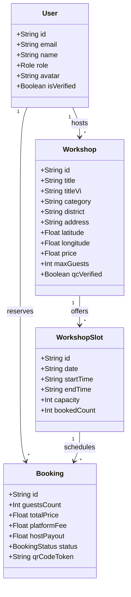

# 04 — Business Domain & Entities 🧩

## 1. Domain Entities & Relationships

---

## 2. Business Rules (BR)

- **BR-001 (Pricing Beachhead):** Experiences target an average price point of **VND 400,000 – VND 500,000** (~$16–$20 USD) for 90–120 minute sessions.
- **BR-002 (Community Take Rate):** The platform retains a **10%–15% commission** (baseline **12%** in MVP). Hosts keep **88%**, deposited directly to their local bank account/e-wallet.
- **BR-003 (Intimate Capacity):** Workshop capacity is strictly capped at **3 to 6 guests** per slot to preserve authenticity and prevent commercial overcrowding of private homes.
- **BR-004 (RAG Grounding Constraint):** The AI Cultural Copilot MUST only provide answers grounded in the host's verified knowledge sheet. If the sheet lacks context, the copilot explicitly declines and suggests contacting the host or community mentor.
- **BR-005 (On-site QC Badge):** An experience only displays the green "Community QC Verified" badge after in-person inspection of the host space and identity verification by the VieBee team.
